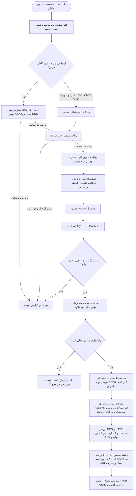
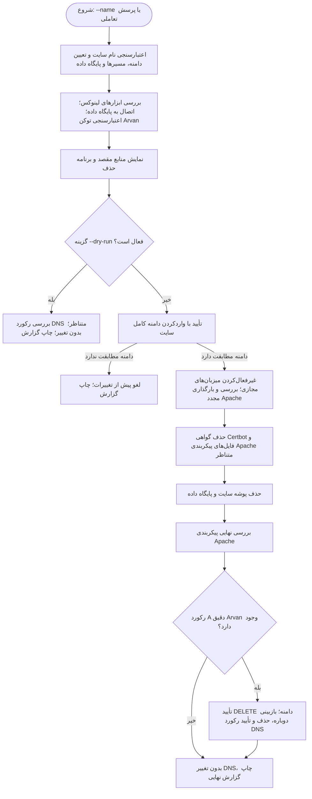

# نصب‌کننده وردپرس

این مخزن شامل دو اسکریپت خط فرمان با پایتون است: یکی برای نصب وردپرس فارسی (`fa_IR`) و دیگری برای حذف سایت‌هایی که در بستر میزبانی `smabf.ir` ساخته شده‌اند.

اسکریپت نصب می‌تواند وردپرس را دریافت کند، فایل‌ها و پیکربندی آن را آماده کند، پایگاه داده MySQL/MariaDB بسازد و در لینوکس رکورد DNS، میزبان مجازی Apache، گواهی Let's Encrypt و پراکسی Arvan Cloud را پیکربندی کند. اسکریپت حذف، منابع متناظر سایت را پاک می‌کند.

## مهم: پیش از استفاده، تنظیمات را بررسی کنید

هر دو اسکریپت در حال حاضر اعتبارنامه‌های موقت پایگاه داده دارند: `DB_USER = "root"` و `DB_PASSWORD = "password"`. اسکریپت نصب این اعتبارنامه‌ها را در فایل `wp-config.php` هر سایت می‌نویسد. **پیش از استفاده روی سرور واقعی، این مقادیر را در هر دو اسکریپت تغییر دهید.** حساب پیکربندی‌شده باید مجوزهای لازم برای پایگاه داده را داشته باشد؛ اسکریپت حذف نیز برای حذف پایگاه داده مقصد به مجوز نیاز دارد. این اسکریپت‌ها حساب کاربری پایگاه داده نمی‌سازند و مجوزی به آن اعطا نمی‌کنند.

تنظیمات پیش‌فرض به دامنه `smabf.ir`، نشانی IP سرور مبدأ `109.122.250.181` و ریشه وب لینوکس `/var/www/html` وابسته است. اگر محیط شما متفاوت است، تنظیمات ابتدای هر دو اسکریپت را بررسی و دامنه، IP مبدأ، مسیرها و تنظیمات پایگاه داده را تغییر دهید.

## فایل‌های مخزن

| فایل | کاربرد |
| --- | --- |
| `wp_installer.py` | دریافت و آماده‌سازی یک سایت جدید وردپرس فارسی؛ در لینوکس، در صورت نیاز DNS، Apache، SSL و Arvan Cloud را هم پیکربندی می‌کند. |
| `wp_uninstaller.py` | حذف پوشه سایت، پایگاه داده، پیکربندی Apache، گواهی و رکورد DNS متناظر Arvan Cloud از سرور لینوکس. |

## روند کار اسکریپت‌ها

این دو اسکریپت مستقل از هم اجرا می‌شوند. اسکریپت نصب، سایت و منابع آن را می‌سازد؛ اسکریپت حذف بعداً با استفاده از همان نام سایت، منابع متناظر را پیدا و حذف می‌کند.

### `wp_installer.py`



اگر نصب پیش از شروع مرحله راه‌اندازی سرور ناموفق شود، اسکریپت تلاش می‌کند فایل‌ها و پوشه‌هایی را که همان اجرا ساخته است پاک کند. پایگاه داده را هیچ‌وقت حذف نمی‌کند. پس از شروع مرحله راه‌اندازی سرور، منابع ساخته‌شده باقی می‌مانند و گزارش نهایی برای پاک‌سازی دستی آن‌ها راهنمایی می‌دهد.

### `wp_uninstaller.py`



تأیید حذف DNS در اسکریپت حذف، پس از حذف منابع محلی سایت انجام می‌شود. اگر این تأیید را ندهید، رکورد DNS باقی می‌ماند، درحالی‌که ممکن است فایل‌های سایت، پایگاه داده، گواهی و پیکربندی‌های Apache قبلاً حذف شده باشند. خطا در هر مرحله گزارش می‌شود و کارهای حذف‌شده به‌صورت خودکار بازگردانده نمی‌شوند.

## اسکریپت نصب چه کارهایی انجام می‌دهد؟

برای نام سایتی مانند `example`، اسکریپت نصب:

1. نام را اعتبارسنجی می‌کند و دامنه `example.smabf.ir` را می‌سازد.
2. پوشه مقصد جدیدی می‌سازد. اگر پوشه از قبل وجود داشته باشد، بدون تغییر آن متوقف می‌شود.
3. آخرین فایل فشرده وردپرس فارسی را از `https://fa.wordpress.org/latest-fa_IR.zip` دریافت و به‌شکل امن استخراج می‌کند.
4. کلیدها و saltهای امنیتی وردپرس را از API وردپرس دریافت می‌کند.
5. فایل `wp-config.php` را با تنظیمات پایگاه داده‌ای که در اسکریپت ثبت شده می‌نویسد.
6. به MySQL/MariaDB وصل می‌شود و پایگاه داده `example_wp` را می‌سازد. اگر این پایگاه داده از قبل وجود داشته باشد، اجرا متوقف می‌شود و آن را دست‌نخورده باقی می‌گذارد.
7. در لینوکس و در صورت استفاده‌نکردن از `--skip-server-setup`، رکورد DNS در Arvan Cloud، میزبان مجازی Apache، گواهی Let's Encrypt، تغییرمسیر HTTPS و پراکسی Arvan Cloud را آماده می‌کند.

پس از پایان اسکریپت، هنوز باید راه‌اندازی وردپرس را در مرورگر تکمیل کنید. ساخت کاربر پایگاه داده و تنظیم مجوزهای آن نیز بر عهده مدیر سرور است.

### راه‌اندازی سرور لینوکس

راه‌اندازی کامل سرور فقط در لینوکس انجام می‌شود و به دسترسی root نیاز دارد. این مرحله از ناحیه و تنظیمات سرور مبدأ که در اسکریپت ثبت شده‌اند استفاده می‌کند. پیش از ساخت فایل‌ها، پایگاه داده یا رکورد DNS، فرمان‌ها، اعتبارنامه‌ها و وضعیت DNS را بررسی می‌کند.

مرحله راه‌اندازی سرور این کارها را به‌ترتیب انجام می‌دهد:

- از رکورد A دقیق و مورد انتظار Arvan Cloud استفاده می‌کند یا رکوردی می‌سازد که به IP سرور مبدأ تنظیم‌شده اشاره کند.
- میزبان مجازی HTTP در Apache را می‌سازد و فعال می‌کند؛ سپس پیکربندی Apache را بررسی می‌کند و فقط در صورت موفقیت، Apache را بارگذاری مجدد می‌کند.
- دسترسی DNS و HTTP را بررسی می‌کند. بررسی `ping` اختیاری است.
- با Certbot از نسخه تولیدی Let's Encrypt گواهی می‌گیرد، آن را نصب می‌کند و تغییرمسیر HTTP به HTTPS را تنظیم می‌کند.
- میزبان مجازی TLS در Apache و گواهی را اعتبارسنجی می‌کند و سپس HTTPS را روی سرور مبدأ بررسی می‌کند.
- پراکسی Arvan Cloud را با HTTPS به سرور مبدأ روی درگاه 443 فعال می‌کند و پاسخ نهایی را بررسی می‌کند.

پس از شروع مرحله DNS/Apache/SSL، اگر مرحله‌ای بعدی شکست بخورد، اسکریپت منابع را به حالت قبل برنمی‌گرداند. گزارش نهایی را بررسی کنید و منابع باقی‌مانده را دستی پاک‌سازی کنید. پیش از این مرحله، اسکریپت در صورت امکان فایل‌ها و پوشه‌هایی را که همان اجرا ساخته است حذف می‌کند؛ اما هیچ‌وقت پایگاه داده را خودکار حذف نمی‌کند.

### ویندوز و نصب فقط وردپرس

در ویندوز، اسکریپت مراحل وردپرس و پایگاه داده را اجرا می‌کند و مراحل DNS، Apache، گواهی و Arvan Cloud را رد می‌کند. مسیر پایه پیش‌فرض `C:\xampp\htdocs` است؛ در اجرای تعاملی می‌توانید مسیر دیگری انتخاب کنید. برای استفاده از سایت همچنان به MySQL/MariaDB و وب‌سروری مجهز به PHP نیاز دارید.

در لینوکس، برای اجرای فقط مراحل وردپرس و پایگاه داده از `--skip-server-setup` استفاده کنید.

## پیش‌نیازها

- پایتون نسخه 3.8 یا جدیدتر.
- MySQL یا MariaDB که روی میزبان و درگاه تنظیم‌شده فعال باشد.
- نصب PyMySQL برای همان مفسر پایتونی که هر یک از اسکریپت‌ها را اجرا می‌کند:

  ```bash
  python3 -m pip install PyMySQL
  ```

- برخی پیکربندی‌های احراز هویت MySQL 8 به `cryptography` هم نیاز دارند:

  ```bash
  python3 -m pip install cryptography
  ```

- برای اجرای وردپرس پس از نصب به وب‌سروری با PHP نیاز دارید. اسکریپت‌ها PHP، Apache یا MySQL/MariaDB را نصب نمی‌کنند.

برای راه‌اندازی کامل سرور لینوکس توسط اسکریپت نصب، این موارد را هم فراهم کنید:

- Apache به‌همراه مسیر `/etc/apache2/sites-available` و فرمان‌های `a2ensite` و `apache2ctl`.
- فرمان‌های `certbot`، `curl` و `openssl`.
- `dig` و `ping` اختیاری هستند؛ اگر نصب نباشند، بررسی آن‌ها رد می‌شود یا از DNS resolver سیستم استفاده می‌شود.
- کلید API آروان در متغیر `ARVAN_API_TOKEN` با مجوز بررسی و به‌روزرسانی رکوردهای DNS برای اسکریپت نصب. اسکریپت حذف برای حذف رکورد A دقیق و متناظر نیز به مجوز نیاز دارد.
- نشانی ایمیل معتبر برای Let's Encrypt در `CERTBOT_EMAIL`.
- دامنه و سرور مبدأ که از اینترنت در دسترس باشند. برای اعتبارسنجی Let's Encrypt، دامنه باید درست resolve شود و ترافیک وب لازم به سرور مبدأ برسد.

اسکریپت حذف فقط در لینوکس اجرا می‌شود. به فرمان‌های `a2dissite`، `apache2ctl`، `systemctl`، `certbot` و `rm`، کتابخانه PyMySQL، دسترسی به سرور MySQL/MariaDB تنظیم‌شده و `ARVAN_API_TOKEN` نیاز دارد.

## پیکربندی

تنظیمات به‌صورت ثابت در ابتدای هر فایل پایتون قرار دارند. مقادیر متناظر را در **هر دو** اسکریپت به‌روزرسانی کنید:

- پایگاه داده: `DB_USER`، `DB_PASSWORD`، `DB_HOST` و `DB_PORT`.
- دامنه و DNS: در اسکریپت نصب `DNS_ZONE`، `SITE_FOLDER_SUFFIX` و `SERVER_IP`؛ در اسکریپت حذف `BASE_DOMAIN`.
- مسیرها: در اسکریپت نصب `LINUX_BASE_DIR` و مسیرهای Apache؛ در اسکریپت حذف `WEB_ROOT` و مسیرهای Apache و Let's Encrypt.

اسکریپت نصب نام پایگاه داده را از `<site-name>_wp` می‌سازد، پیشوند جدول‌ها را `wp_` قرار می‌دهد و پایگاه داده را با `utf8mb4` و یک collation پشتیبانی‌شده می‌سازد. حساب پایگاه داده یا مجوزهای آن را ایجاد و تنظیم نمی‌کند.

توکن API و ایمیل Let's Encrypt از متغیرهای محیطی خوانده می‌شوند. توکن را در مخزن کد قرار ندهید و در لاگ‌ها ثبت نکنید. در لینوکس مطمئن شوید `sudo` متغیرهای لازم را به اسکریپت منتقل می‌کند. برای نمونه، پس از تعریف متغیرها در shell:

```bash
export ARVAN_API_TOKEN='your-arvan-api-token'
export CERTBOT_EMAIL='admin@example.com'
sudo --preserve-env=ARVAN_API_TOKEN,CERTBOT_EMAIL python3 wp_installer.py --name example
```

ممکن است سیاست `sudo` شما نیازمند اجازه برای حفظ این متغیرها باشد. اسکریپت حذف فقط به توکن آروان نیاز دارد:

```bash
sudo --preserve-env=ARVAN_API_TOKEN python3 wp_uninstaller.py --name example --dry-run
```

## نصب سایت

### لینوکس: وردپرس، پایگاه داده و راه‌اندازی سرور

PyMySQL را برای مفسر پایتونی‌ای نصب کنید که با `sudo` اجرا می‌شود، تنظیمات را پیکربندی کنید، توکن آروان و ایمیل تماس را در محیط تعریف کنید و سپس اجرا کنید:

```bash
sudo --preserve-env=ARVAN_API_TOKEN,CERTBOT_EMAIL python3 wp_installer.py --name example
```

فایل‌ها به‌طور پیش‌فرض در `/var/www/html/example.smabf.ir` قرار می‌گیرند. اگر راه‌اندازی موفق باشد، `https://example.smabf.ir/wp-admin/install.php` را باز کنید و تنظیم سایت وردپرس را تکمیل کنید.

### لینوکس: فقط وردپرس و پایگاه داده

```bash
sudo python3 wp_installer.py --name example --skip-server-setup
```

این حالت هم به اتصال فعال پایگاه داده و مجوز ساخت `example_wp` نیاز دارد. پیش از بازکردن صفحه راه‌اندازی وردپرس، وب‌سرور را جداگانه پیکربندی کنید.

### ویندوز

```powershell
py -3 -m pip install PyMySQL
py -3 wp_installer.py --name example
```

مسیر پیش‌فرض `C:\xampp\htdocs\example.smabf.ir` است. اگر XAMPP فعال باشد، صفحه نصب محلی معمولاً در `http://localhost/example.smabf.ir/wp-admin/install.php` قرار دارد.

### گزینه‌های خط فرمان نصب‌کننده

برای مشاهده راهنمای فعلی، `python3 wp_installer.py --help` را اجرا کنید. در ویندوز از `py -3 wp_installer.py --help` استفاده کنید.

| گزینه | توضیح |
| --- | --- |
| `--name NAME` | نام سایت بدون پسوند دامنه. اگر وارد نشود، اسکریپت آن را از شما می‌پرسد. نام به حروف کوچک تبدیل می‌شود، باید ۱ تا ۶۱ نویسه داشته باشد و فقط از حروف انگلیسی، رقم و خط تیره میانی تشکیل شود؛ `.smabf.ir` را وارد نکنید. |
| `--base-dir PATH` | مسیر پایه مطلق سایت. نسبت به متغیر محیطی `WP_INSTALLER_BASE_DIR` اولویت دارد. |
| `--skip-server-setup` | مراحل DNS، Apache، SSL و Arvan Cloud در لینوکس را رد می‌کند. |
| `-v`، `--verbose` | برای عیب‌یابی، جزئیات traceback را نمایش می‌دهد. |

اگر `--base-dir` یا `WP_INSTALLER_BASE_DIR` تعیین نشده باشد، مسیر لینوکس `/var/www/html` است. در ویندوز مسیر `C:\xampp\htdocs` استفاده می‌شود و در ترمینال تعاملی ممکن است مسیر پایه از شما پرسیده شود.

## حذف سایت

اسکریپت حذف مسیرها و پایگاه داده را از نام معتبر سایت به‌دست می‌آورد. ابتدا محیط را بررسی می‌کند، به MySQL/MariaDB وصل می‌شود، وضعیت توکن آروان را بررسی می‌کند و برنامه حذف را نمایش می‌دهد.

ابتدا اجرای آزمایشی انجام دهید:

```bash
sudo --preserve-env=ARVAN_API_TOKEN python3 wp_uninstaller.py --name example --dry-run
```

اجرای آزمایشی فرمانی برای تغییر منابع اجرا نمی‌کند و رکورد DNS را حذف نمی‌کند. بااین‌حال، برای بررسی منابع مقصد به ابزارهای لینوکس، اتصال پایگاه داده و توکن معتبر آروان نیاز دارد.

برای حذف واقعی، `--dry-run` را بردارید:

```bash
sudo --preserve-env=ARVAN_API_TOKEN python3 wp_uninstaller.py --name example
```

پیش از شروع، اسکریپت از شما می‌خواهد دامنه کامل `example.smabf.ir` را وارد کنید. سپس میزبان‌های مجازی سایت را در Apache غیرفعال می‌کند، پیکربندی را بررسی و Apache را بارگذاری مجدد می‌کند، گواهی Certbot متناظر را حذف می‌کند، فایل‌های پیکربندی Apache و پوشه سایت را پاک می‌کند و پایگاه داده `example_wp` را حذف می‌کند. حذف رکورد A دقیق و متناظر Arvan Cloud آخرین عملیات است.

برای حذف DNS، تأیید دوم هم لازم است: عبارت `DELETE example.smabf.ir` را وارد کنید. این درخواست پس از حذف منابع محلی سایت نمایش داده می‌شود. اگر آن را تأیید نکنید، رکورد DNS باقی می‌ماند، درحالی‌که ممکن است فایل‌های سایت، پایگاه داده، گواهی و پیکربندی‌های Apache حذف شده باشند. اسکریپت گزارش نهایی هر مرحله و وضعیت منابع را چاپ می‌کند.

### گزینه‌های خط فرمان حذف‌کننده

| گزینه | توضیح |
| --- | --- |
| `--name NAME` | نام سایت بدون `.smabf.ir`. اگر وارد نشود، اسکریپت آن را از شما می‌پرسد. |
| `--dry-run` | عملیات حذف را بررسی و گزارش می‌کند، بدون آنکه منابع سیستم را تغییر دهد. |

## نکات ایمنی و عملیاتی

- اگر پوشه سایت یا پایگاه داده از قبل وجود داشته باشد، اسکریپت نصب متوقف می‌شود و محتوای موجود را دست‌نخورده می‌گذارد.
- استخراج ZIP مسیرهای فایل را اعتبارسنجی می‌کند و برای اندازه بایگانی و تعداد ورودی‌ها محدودیت دارد.
- اسکریپت نصب پایگاه داده را حذف نمی‌کند. اگر اجرا پس از ساخت پایگاه داده با خطا مواجه شود، پایگاه داده باقی می‌ماند.
- پس از شروع مرحله راه‌اندازی سرور، اسکریپت نصب تغییرات DNS، Apache، گواهی یا Arvan Cloud را بازنمی‌گرداند.
- اسکریپت حذف مخرب است: پس از تأییدهای لازم، فایل‌ها و پایگاه داده سایت مشتق‌شده از نام را حذف می‌کند و رکورد A دقیق Arvan Cloud را پاک می‌کند. مسیرهای نمایش‌داده‌شده را بررسی و پیش از اجرا نسخه پشتیبان تهیه کنید.
- اسکریپت حذف پیش از پاک‌سازی مسیرها را بررسی می‌کند و از حذف هدف‌های نمادین، تغییرمسیر‌یافته، mountشده یا غیرمنتظره خودداری می‌کند. در صورت ابهام بین چند رکورد DNS نیز متوقف می‌شود.
- هیچ‌کدام از اسکریپت‌ها کاربر جداگانه وردپرس را در پایگاه داده نمی‌سازند و مجوزی اعمال نمی‌کنند. با تنظیمات فعلی، سایت‌های ساخته‌شده با کاربر `root` به MySQL وصل می‌شوند؛ پیش از استفاده واقعی حسابی با دسترسی محدودتر پیکربندی کنید.

## خروجی و عیب‌یابی

هر دو اسکریپت پیام‌های وضعیت زمان‌دار و گزارش نهایی چاپ می‌کنند. رمز پایگاه داده یا توکن آروان در لاگ‌های عادی چاپ نمی‌شود. برای دیدن جزئیات traceback در اسکریپت نصب از `-v` استفاده کنید.

خطاهای رایج:

- **خطای ورود یا مجوز MySQL:** مقادیر `DB_USER`، `DB_PASSWORD`، `DB_HOST` و `DB_PORT` را در هر دو اسکریپت بررسی کنید و مطمئن شوید حساب برای ساخت یا حذف پایگاه داده مقصد مجوز دارد.
- **خطای import برای PyMySQL:** PyMySQL را برای همان مفسر پایتونی نصب کنید که اسکریپت را اجرا می‌کند؛ مفسری که زیر `sudo` اجرا می‌شود نیز باید آن را داشته باشد.
- **خطای Arvan API:** مطمئن شوید `ARVAN_API_TOKEN` تعریف شده و به ناحیه DNS تنظیم‌شده دسترسی کافی دارد.
- **خطای اعتبارسنجی گواهی:** بررسی کنید DNS به سرور مبدأ اشاره کند، وب‌سرور روی درگاه‌های لازم در دسترس باشد و `CERTBOT_EMAIL` معتبر باشد.
- **خطای راه‌اندازی Apache:** نصب بودن فرمان‌های لازم، موفقیت `apache2ctl configtest` و اجرای اسکریپت با دسترسی root را بررسی کنید.

## مجوز

این مخزن در حال حاضر فایل مجوز ندارد. برای مشخص‌کردن شرایط استفاده و بازتوزیع پروژه، فایل `LICENSE` اضافه کنید.
