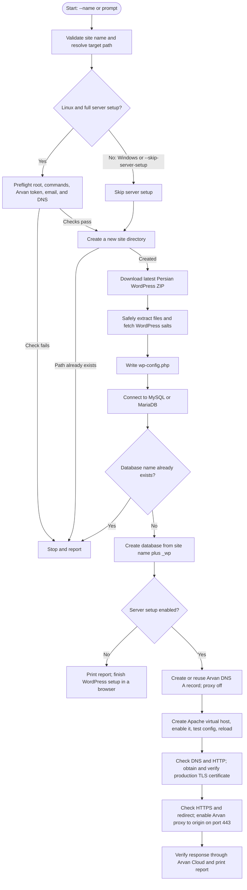
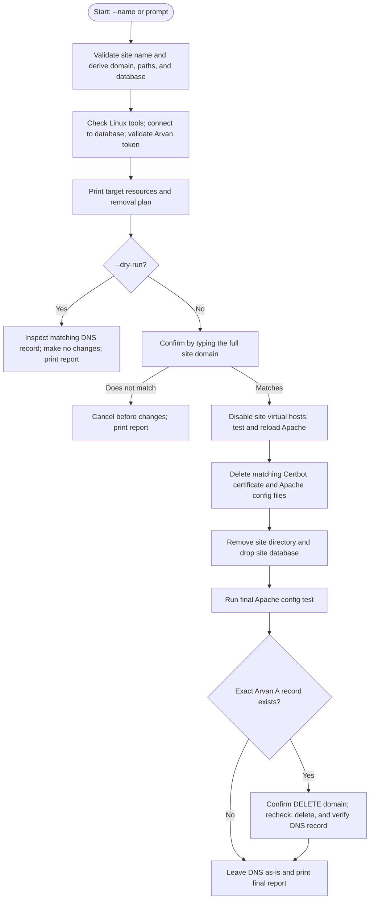

# WordPress Installer

A pair of Python command-line scripts for installing Persian (`fa_IR`) WordPress sites and removing sites created for the `smabf.ir` hosting setup.

The installer can download WordPress, prepare its files and configuration, create a MySQL/MariaDB database, and (on Linux) configure the site's DNS record, Apache virtual host, Let's Encrypt certificate, and Arvan Cloud proxy. The uninstaller removes the corresponding site resources.

## Important: review the settings before using this project

Both scripts currently contain temporary database credentials in their settings: `DB_USER = "root"` and `DB_PASSWORD = "password"`. The installer writes these credentials into each generated `wp-config.php`. **Change these values in both scripts before using them on a real server.** The configured account needs the database privileges required by your setup; the uninstaller also needs permission to drop the target database. These scripts do not create database users or grant privileges.

The default setup is tied to `smabf.ir`, the origin IP `SERVER_IP`, and the `/var/www/html` web root on Linux. Review the settings near the top of both scripts and change the domain, origin IP, paths, and database settings if your environment differs.

## Repository contents

| File | Purpose |
| --- | --- |
| `wp_installer.py` | Downloads and prepares a new Persian WordPress site; optionally configures DNS, Apache, SSL, and Arvan Cloud on Linux. |
| `wp_uninstaller.py` | Removes the matching site directory, database, Apache configuration, certificate, and Arvan Cloud DNS record from a Linux server. |

## How the scripts work

The scripts run independently. The installer creates the site and its resources; the uninstaller later derives the corresponding resources from the same site name and removes them.

### `wp_installer.py`



If installation fails before the server phase, the script attempts to remove files and folders created by that run. It never drops a database. Once the server phase starts, it leaves created resources in place and reports them for manual cleanup.

### `wp_uninstaller.py`



The uninstaller's DNS confirmation comes after the local site resources have been removed. If that confirmation is declined, the DNS record remains while the site files, database, certificate, and Apache configs may already be gone. A failure at any stage is reported; completed removal steps are not automatically rolled back.

## What the installer does

For a site name such as `example`, the installer:

1. Validates the name and uses it to form `example.smabf.ir`.
2. Creates a new target folder. It stops without changing an existing folder.
3. Downloads the current Persian WordPress ZIP from `https://fa.wordpress.org/latest-fa_IR.zip` and safely extracts it.
4. Retrieves WordPress security keys and salts from the WordPress API.
5. Writes `wp-config.php` with the database settings from the script.
6. Connects to MySQL/MariaDB and creates the database `example_wp`. If that database already exists, the run stops and leaves it untouched.
7. On Linux, unless `--skip-server-setup` is used, prepares the Arvan Cloud DNS A record, Apache virtual host, Let's Encrypt certificate, HTTPS redirect, and Arvan Cloud proxy.

The browser-based WordPress setup still needs to be completed after the script finishes. It also leaves database-user creation and privilege configuration to the server administrator.

### Linux server setup

The full server setup is Linux-only and requires root privileges. It uses the fixed zone and origin settings in the script. Before creating files, a database, or a DNS record, it checks the required commands, credentials, and DNS state.

The server phase performs these operations in order:

- Reuse the exact expected Arvan Cloud A record or create one pointing to the configured origin IP.
- Create the Apache HTTP virtual host, enable it, test the Apache configuration, and reload Apache if the test passes.
- Check DNS and HTTP reachability. `ping` is an optional diagnostic.
- Use Certbot with Let's Encrypt production to obtain and install a certificate and configure HTTP-to-HTTPS redirection.
- Verify the Apache TLS virtual host and certificate, then check HTTPS on the origin.
- Enable the Arvan Cloud proxy with HTTPS to the origin on port 443 and verify the final response.

Once the DNS/Apache/SSL phase begins, the installer does not roll back resources if a later step fails. Review its final report and clean up any remaining resources manually. Before that phase, it removes files and folders created by that run when possible; it never drops a database automatically.

### Windows and WordPress-only setup

On Windows, the installer performs the WordPress and database steps and skips the DNS, Apache, certificate, and Arvan Cloud steps. The default base directory is `C:\xampp\htdocs`; when run interactively, you can choose another directory. A MySQL/MariaDB server and a web server with PHP are still needed to use the site.

Use `--skip-server-setup` on Linux to run only the WordPress and database steps.

## Requirements

- Python 3.8 or later.
- MySQL or MariaDB running at the configured host and port.
- PyMySQL installed for the Python interpreter used to run either script:

  ```bash
  python3 -m pip install PyMySQL
  ```

- Some MySQL 8 authentication configurations also require `cryptography`:

  ```bash
  python3 -m pip install cryptography
  ```

- A PHP-enabled web server is required to run WordPress after installation. The scripts do not install PHP, Apache, or MySQL/MariaDB.

For the installer's full Linux server setup, also provide:

- Apache with `/etc/apache2/sites-available` and the `a2ensite` and `apache2ctl` commands.
- `certbot`, `curl`, and `openssl`.
- `dig` and `ping` are optional; their checks are skipped or use the system resolver when unavailable.
- An Arvan Cloud API key in `ARVAN_API_TOKEN` with permission to inspect and update DNS records for the installer. The uninstaller also needs permission to delete the exact matching A record.
- A valid Let's Encrypt contact address in `CERTBOT_EMAIL`.
- A publicly reachable domain and origin server. Let's Encrypt validation needs the domain to resolve correctly and the origin to accept the required web traffic.

The uninstaller is Linux-only. It needs `a2dissite`, `apache2ctl`, `systemctl`, `certbot`, `rm`, PyMySQL, access to the configured MySQL/MariaDB server, and `ARVAN_API_TOKEN`.

## Configuration

The settings are constants near the top of each Python file. Update the matching values in **both** scripts:

- Database: `DB_USER`, `DB_PASSWORD`, `DB_HOST`, `DB_PORT`.
- Domain and DNS: installer `DNS_ZONE`, `SITE_FOLDER_SUFFIX`, `SERVER_IP`; uninstaller `BASE_DOMAIN`.
- Paths: installer `LINUX_BASE_DIR` and Apache paths; uninstaller `WEB_ROOT` and Apache/Let's Encrypt paths.

The installer names the database `<site-name>_wp`, uses the `wp_` table prefix, and creates the database with `utf8mb4` and a supported collation. It does not create a database account or adjust permissions.

The API token and Let's Encrypt email are read from environment variables. Keep the token out of source control and logs. On Linux, make sure `sudo` passes the required variables to the script; for example, after exporting them in your shell:

```bash
export ARVAN_API_TOKEN='your-arvan-api-token'
export CERTBOT_EMAIL='admin@example.com'
sudo --preserve-env=ARVAN_API_TOKEN,CERTBOT_EMAIL python3 wp_installer.py --name example
```

Your `sudo` policy may need to allow preserving these variables. The uninstaller only needs the Arvan token:

```bash
sudo --preserve-env=ARVAN_API_TOKEN python3 wp_uninstaller.py --name example --dry-run
```

## Install a site

### Linux: WordPress, database, and server setup

Install PyMySQL for the Python interpreter that will run under `sudo`, configure the settings, export the Arvan token and contact email, then run:

```bash
sudo --preserve-env=ARVAN_API_TOKEN,CERTBOT_EMAIL python3 wp_installer.py --name example
```

The resulting files go to `/var/www/html/example.smabf.ir` by default. If setup succeeds, open `https://example.smabf.ir/wp-admin/install.php` and finish the WordPress site setup.

### Linux: WordPress and database only

```bash
sudo python3 wp_installer.py --name example --skip-server-setup
```

This still requires a working database connection and permission to create `example_wp`. Configure your web server separately before opening the WordPress setup page.

### Windows

```powershell
py -3 -m pip install PyMySQL
py -3 wp_installer.py --name example
```

The default destination is `C:\xampp\htdocs\example.smabf.ir`. With XAMPP running, the local setup page is typically `http://localhost/example.smabf.ir/wp-admin/install.php`.

### Installer command-line options

Run `python3 wp_installer.py --help` (or `py -3 wp_installer.py --help` on Windows) for the current help text.

| Option | Description |
| --- | --- |
| `--name NAME` | Site name without the domain suffix. If omitted, the script prompts for it. Names are lowercased, 1–61 characters long, and use English letters, digits, and internal hyphens; do not include `.smabf.ir`. |
| `--base-dir PATH` | Absolute base directory for the site. Takes precedence over the `WP_INSTALLER_BASE_DIR` environment variable. |
| `--skip-server-setup` | Skip Linux steps for DNS, Apache, SSL, and Arvan Cloud. |
| `-v`, `--verbose` | Include traceback details for troubleshooting. |

Without `--base-dir` or `WP_INSTALLER_BASE_DIR`, Linux uses `/var/www/html`. Windows uses `C:\xampp\htdocs` and may prompt for a base directory in an interactive terminal.

## Remove a site

The uninstaller targets the paths and database derived from one validated site name. It first checks the environment, connects to MySQL/MariaDB, reads the Arvan DNS state, and prints the planned actions.

Start with a dry run:

```bash
sudo --preserve-env=ARVAN_API_TOKEN python3 wp_uninstaller.py --name example --dry-run
```

The dry run sends no system-changing commands and does not delete the DNS record. It still requires the Linux tools, a database connection, and a working Arvan API token so it can inspect the target resources.

For actual removal, omit `--dry-run`:

```bash
sudo --preserve-env=ARVAN_API_TOKEN python3 wp_uninstaller.py --name example
```

The script asks you to type the full domain, `example.smabf.ir`, before it starts. It then disables the site's Apache virtual hosts, checks and reloads Apache, deletes the matching Certbot certificate, removes the matching Apache config files and site directory, and drops `example_wp`. Deleting the exact matching Arvan Cloud A record is the final operation.

The DNS deletion has a second confirmation prompt: type `DELETE example.smabf.ir`. This prompt occurs after the local site resources have been removed. If you decline it, the DNS record stays in place while the site files, database, certificate, and Apache configs may already be gone. The uninstaller prints a final report of each stage and the resources it finds.

### Uninstaller command-line options

| Option | Description |
| --- | --- |
| `--name NAME` | Site name without `.smabf.ir`. If omitted, the script prompts for it. |
| `--dry-run` | Inspect and report planned removal without changing system resources. |

## Safety and operational notes

- The installer refuses an existing site directory or database. Existing contents are left untouched.
- ZIP extraction validates paths and limits the archive size and entry count.
- The installer never drops databases. If a run fails after creating a database, the database remains.
- The installer does not roll back DNS, Apache, certificate, or Arvan Cloud changes after the server phase starts.
- The uninstaller is destructive. It removes the derived site's files and database and deletes its exact matching DNS A record after explicit confirmations. Review the printed target paths and make backups first.
- The uninstaller checks paths before removal and refuses symlinked, redirected, mounted, or unexpected targets. It also refuses ambiguous DNS matches.
- Neither script creates a separate WordPress database user or applies grants. With the current source defaults, generated sites connect to MySQL as `root`; configure an appropriately restricted account before real use.

## Output and troubleshooting

Both scripts print timestamped status messages and a final report. Neither script prints its configured database password or Arvan token in normal logs. Use `-v` with the installer to see traceback details.

Common issues:

- **MySQL authentication or permission error:** check `DB_USER`, `DB_PASSWORD`, `DB_HOST`, and `DB_PORT` in both scripts, and confirm the account can create or drop the target database as needed.
- **PyMySQL import error:** install PyMySQL for the same Python interpreter used to launch the script, including the interpreter used under `sudo`.
- **Arvan API error:** confirm `ARVAN_API_TOKEN` is set and has sufficient access to the configured DNS zone.
- **Certificate validation error:** confirm DNS points to the origin, the web server is reachable on the required ports, and `CERTBOT_EMAIL` is valid.
- **Apache setup error:** check that the required commands are installed, Apache's configuration passes `apache2ctl configtest`, and the script is run with root privileges.

## License

This project is licensed under the terms described in [LICENSE](LICENSE).

You can see Persian document in this [link](https://smabf7899.github.io/Wordpress-Installer/README.fa.html)
